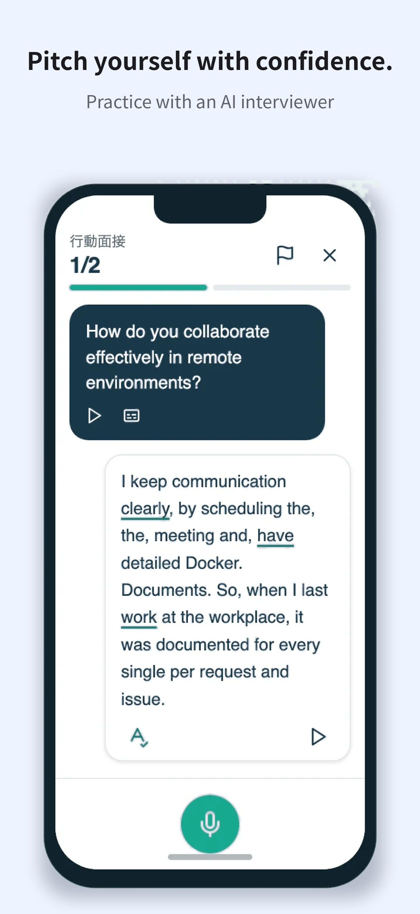
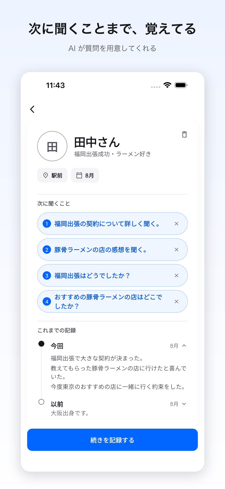

## 👋 About Me

Hi, I'm **Kazuki**, an indie developer from **Osaka, Japan**.
I design, build, and ship my own apps — currently **canpitch** and **Kivori**.
Before going indie, I worked as a fullstack engineer for 4+ years, turning raw ideas into structured, detail-oriented products.

### Contact Me

kazukijo.dev@gmail.com

## 📱 What I'm Building

 

### canpitch

canpitch is interview practice for Japanese-speaking job changers aiming at foreign and overseas tech companies.

If you freeze when speaking about your experience in the STAR format, canpitch helps you answer in your own words, instead of memorized scripts.

- One question at a time — sessions start with your self-introduction
- Feedback on every answer, based on your own words
- A view of how your answers sound to an interviewer

iOS / Android · Flutter · Beta on TestFlight

[canpitch.com](https://canpitch.com)

 
 

 
 

### Kivori

Kivori is a quiet, private CRM for remembering the people you meet at networking events and business meetings.

Talk for a few seconds right after a meeting, and Kivori turns your voice memo into a card about that person.

- An AI summary of what you talked about and what matters to them
- A question to ask next time, ready before you meet again
- A reminder before the next meeting, so names and details come back

iOS · Free · On the App Store

[App Store](https://apps.apple.com/jp/app/kivori-%E3%82%AD%E3%83%9C%E3%83%AA-%E4%BA%BA%E8%84%88%E3%83%A1%E3%83%A2-%E4%BC%9A%E3%81%A3%E3%81%9F%E4%BA%BA%E3%82%92%E8%A8%98%E9%8C%B2/id6787627401?uo=4)

 

## 🛠️ Tech Stack

### Frontend

### Backend

### Infrastructure / DB

### Tools

## 🎯 Current Goal

Growing canpitch's beta toward its public release — and building toward doing business in Canada.

## 🌐 Portfolio

Visit my portfolio: [kazuki0418.vercel.app](https://portfolio-i468-qc8uv3vtv-kazuki0418s-projects.vercel.app)
